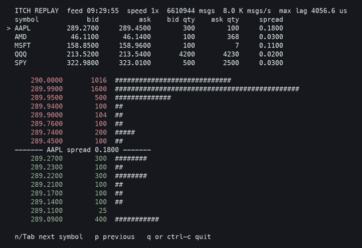
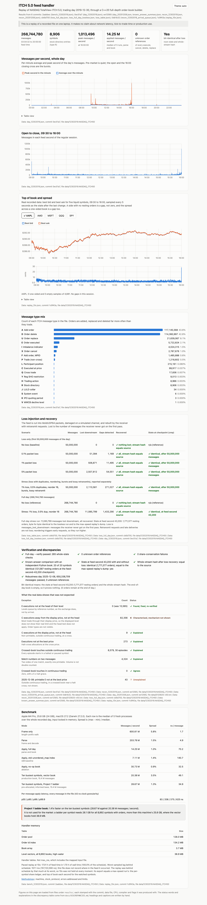
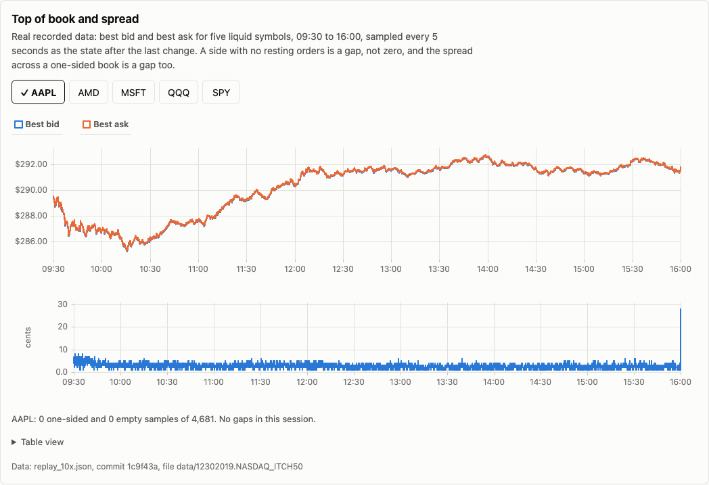
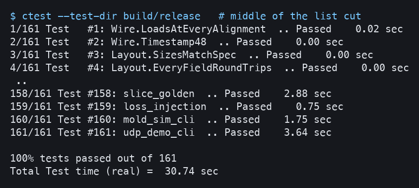
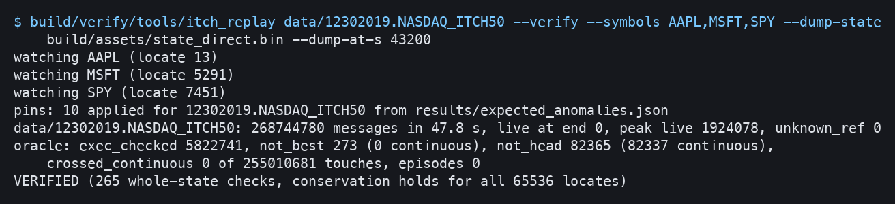
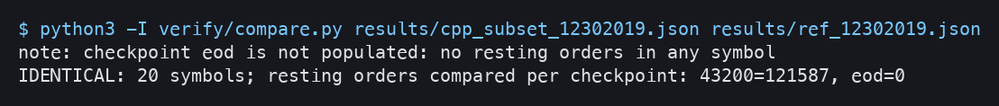
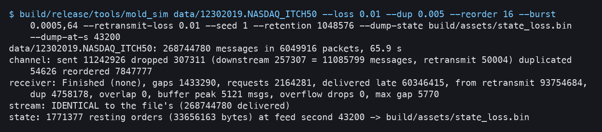
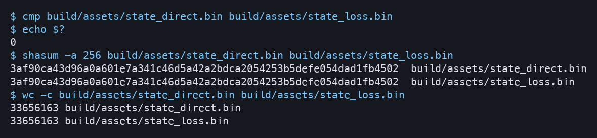
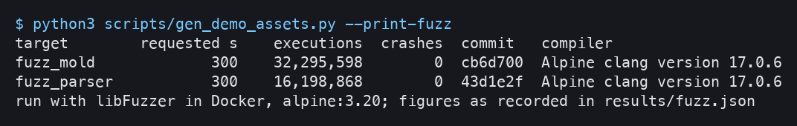

# NASDAQ ITCH 5.0 feed handler

A C++20 feed handler that replays one full recorded NASDAQ trading day (<!-- gen:messages_m -->268.7 M<!-- /gen --> messages) at <!-- gen:apply_mps -->14.25 M<!-- /gen --> msgs/s on one thread of an <!-- gen:cpu -->Apple M4 Pro<!-- /gen -->, rebuilds every symbol's order book, and recovers from injected MoldUDP64 loss to bit-identical state.

<!-- gen:badges --><!-- /gen -->

This is a replay of recorded files. CI and the two-minute demo use synthetic data committed here. The full-day results come from the real file, which you download from NASDAQ. Nothing here is a network latency, tick-to-trade or production claim. "Bit-identical" means two things only: the resting-order state at feed second <!-- gen:noon_second -->43,200<!-- /gen --> (<!-- gen:noon_orders -->1,771,377<!-- /gen --> orders), and the SHA-256 of the whole delivered stream. The end-of-day book is empty, so comparing it would prove nothing.



Real data for real symbols, aggregated by price level, 30 s around the open. `itch_replay data/12302019.NASDAQ_ITCH50 --speed 1 --from 09:29:50 --tui AAPL,MSFT,SPY,QQQ,AMD`

## Proof

Each number below is generated from the stamped file named beside it by `scripts/gen_docs.py`, and CI fails if a block goes stale. <!-- gen:provenance -->The current result files come from 13 commits: `a917fa5`, `7f99fcb`, `67707b0`, `ce42ef2`, `bae9ecc`, `a09caac`, `2c3e5da`, `8358d96`, `78384b4`, `ca1e418`, `c54ba4f`, `93efea9`, `b5f86a4`. The kScan screening and the profile come from patched builds and say so in their own files.<!-- /gen -->

<!-- gen:proof_table -->

| Claim | Result | File | Reproduce |
|---|---|---|---|
| Full real day replayed and checked | 268,744,780 messages, `unknown_ref` 0, conservation holds, 265 whole-state checks, no book crossed in continuous trading with a 5 s grace after a resume (634 crossed touches at 0 s of grace, all within 1.214 ms of a resume) | [`day_12302019.json`](results/day_12302019.json) | `itch_replay data/12302019.NASDAQ_ITCH50 --verify` |
| Second day, six years later | 650,338,709 messages, `unknown_ref` 0, peak 5,271,230 live orders; no new message types | [`day_20251208.json`](results/day_20251208.json) | `itch_replay data/S120825-v50.txt --verify` |
| Agrees with a separate Python reference | 20 symbols, identical field for field, 121,587 resting orders at noon, 6.9% of noon orders, 2019 only. No shared code, same author; shares the queue rule | [`known_answer_summary.json`](results/known_answer_summary.json); its inputs hold resting orders, so they are reproducible and not committed | `itch_replay <day> --export-orders <symbols> results/cpp_subset_12302019.json`, `verify/reference_book.py`, then `verify/compare.py` |
| Bit-identical books after injected loss | 11,085,799 messages lost (`messages_lost_downstream`) and recovered; state at feed second 43,200 (1,771,377 resting orders) and stream hash both equal the lossless run. The end-of-day book is empty, so it proves nothing | [`loss_full_day.json`](results/loss_full_day.json), [`loss_full_day_lossless.json`](results/loss_full_day_lossless.json) | `mold_sim <day> --loss 0.01 --dup 0.005 --reorder 16 --burst 0.0005,64 --retransmit-loss 0.01 --seed 1 --retention 1048576 --dump-state s.bin --dump-at-s 43200`, then `cmp` |
| Throughput, single thread, file replay | 14.25 M msgs/s applied, 203.76 M msgs/s parsed, on Apple M4 Pro | [`bench_12302019.json`](results/bench_12302019.json) | `scripts/run_bench.py --day 12302019` |
| Per-message latency shape | p50 83 ns, p99 375 ns, p99.9 625 ns, quantized at 42 ns. From a separately timed run at 9.92 M msgs/s, 100.8 ns per message, with two clock reads per message; throughput comes from runs with no per-message clock | [`bench_12302019.json`](results/bench_12302019.json) | `scripts/run_bench.py --day 12302019` |
| Paced replay gives the same export as a max-speed run | 10x, 1.70 h of wall time. Its export equals a max-speed run's: the per-symbol share ledger, and top of book each second for 5 symbols. The 10x run takes no state dump | [`replay_10x.json`](results/replay_10x.json), [`replay_max_compare.json`](results/replay_max_compare.json) | `itch_replay <day> --speed 10 --symbols QQQ,SPY,AAPL,AMD,MSFT --export out.json`, then `scripts/record_replay_compare.py` |
| Recovery over real sockets, loopback only | First 5,000,000 messages at 1,000,000 msgs/s, stream and state identical | [`udp_demo.json`](results/udp_demo.json) | `mold_udp_demo <day> --max-messages 5000000 --drop 0.01 --seed 1 --rate-mps 1000000 --dump-state s.bin --dump-at-s 25000 --check-direct` |
| Parser and receiver fuzzed (libFuzzer, in Docker) | `fuzz_parser` 16,198,868 executions, `fuzz_mold` 32,295,598 executions, 0 crashes | [`fuzz.json`](results/fuzz.json) | `scripts/fuzz.sh fuzz_parser 300` |
| Closing prices against public closes | 7 of 7 equal on the raw 2019 basis. Rests mostly on Yahoo; the CMCSA split factor is unconfirmed | [`recon_12302019.json`](results/recon_12302019.json) | `verify/recon_summary.py build/r_day.pickle build/recon_match.json verify/closing_sources.json results/halt_grace_12302019.json --out results/recon_12302019.json` |

<!-- /gen -->

## Screenshots

Each image is the captured output of the command in its caption, made by `scripts/gen_demo_assets.py`.

**Dashboard.** Static page fed by JSON exported from `results/`. Serve it with `python3 -m http.server -d dashboard 8000`.



**Top of book and spread panel**, same page.



**Tests.** `ctest --test-dir build/release`



**Full-day verify, zero unknown references.** `build/verify/tools/itch_replay data/12302019.NASDAQ_ITCH50 --verify --symbols AAPL,MSFT,SPY --dump-state build/assets/state_direct.bin --dump-at-s 43200`



**Known-answer comparison, on local output that is not committed.** `python3 -I verify/compare.py results/cpp_subset_12302019.json results/ref_12302019.json`



**Loss run with gap and recovery counts.** `build/release/tools/mold_sim data/12302019.NASDAQ_ITCH50 --loss 0.01 --dup 0.005 --reorder 16 --burst 0.0005,64 --retransmit-loss 0.01 --seed 1 --retention 1048576 --dump-state build/assets/state_loss.bin --dump-at-s 43200`



**The silent `cmp`, with file hashes.** `cmp build/assets/state_direct.bin build/assets/state_loss.bin`, then `shasum -a 256` on both.



**Fuzz summary.** `python3 scripts/gen_demo_assets.py --print-fuzz`, which prints `results/fuzz.json`.



<!-- This block shows the proofs that need a public repository, once their image files exist. -->
<!-- gen:public_proofs --><!-- /gen -->

## Try it in two minutes

Prerequisites: CMake 3.25 or newer (the apt package on Ubuntu 22.04 is 3.22, too old), a C++20 compiler (AppleClang 21 here, GCC 13 builds with `-Werror`), Python 3 and network access for the first configure.

CI and the two-minute demo use synthetic data: one invented day for eight invented symbols, written from a seed by `scripts/gen_synthetic_itch.py`. It shows that the handler works and how to check it. It says nothing about real market behaviour, and none of the figures above come from it. See `testdata/README.md`.

```
cmake --preset release && cmake --build --preset release -j
python3 scripts/prepare_slice.py --out build/testdata/synthetic.itch
python3 scripts/check_slice.py --replay build/release/tools/itch_replay --slice build/testdata/synthetic.itch
build/release/tools/mold_sim build/testdata/synthetic.itch --loss 0.01 --dup 0.005 --reorder 16 \
    --burst 0.0005,64 --retransmit-loss 0.01 --seed 1 \
    --dump-state /tmp/s.bin --dump-at-s 43200 --check-direct
python3 -m http.server -d dashboard 8000
```

`check_slice.py` replays the file with every check on, compares the export with the golden file, then runs the independent Python reference over all eight symbols and compares them field for field. You should see `VERIFIED` and `IDENTICAL`, then an identical state from `mold_sim`. The first run fetches two dependencies with CMake's FetchContent (GoogleTest and Project 1). The dashboard shows the committed real-day results.

To reproduce the full-day results, download the real file from NASDAQ. It is a <!-- gen:day_gz_bytes -->3.52 GB<!-- /gen --> download that decompresses to <!-- gen:day_bytes -->8.25 GB<!-- /gen -->. Download time depends on Nasdaq's server. One apply pass with setup then took about <!-- gen:apply_wall_s -->24 s<!-- /gen --> here.

```
python3 scripts/fetch_itch.py 12302019.NASDAQ_ITCH50.gz
build/release/tools/itch_replay data/12302019.NASDAQ_ITCH50 --verify
```

Rebuilding every committed result from a clean commit is one script: `scripts/regenerate_results.sh`. Run it with `--dry-run` to see what it will do and how long the recorded jobs took.

## Architecture

```
ITCH file (mmap)                MoldUDP64 simulator or loopback UDP
      |                                     |
      |                         Receiver: sequence check, gaps, retransmit
      |                                     |
      +------------------+------------------+
                         v
        Framer -> decode (zero-copy views, memcpy + byte swap)
                         v
        BookBuilder: stock_locate -> dense array of 65,536 books
                         |          one global order pool and id index
                         v
        Observer (template parameter): none for the benchmark,
        invariants + oracle + stats for --verify
                         v
        JSON export -> results/ -> dashboard/      Seqlock snapshot -> --tui
```

The hot path has one thread. Details and the evidence for each decision are in [DESIGN.md](DESIGN.md).

| Structure | Choice | Why |
|---|---|---|
| Symbol routing | `stock_locate` indexes a vector of 65,536 books | The feed gives a 2-byte integer, so nothing hashes a string and a `u16` cannot go out of bounds |
| Order map | Open-addressed `IdIndex` over a pre-reserved `OrderPool` | <!-- gen:index_speedup -->2.0x<!-- /gen --> faster than a reserved `std::unordered_map` on the full day. Exhausting capacity stops the run with an error; it never rehashes or drops an order |
| Price levels | Per-side sorted vector, best at the back | Exact raw prices with no window or overflow path. A scan from the back finds most levels near the touch |
| Queue in a level | Linked through the pool, in reference-number order | The real data showed this is the exchange's order. See "What was found" |
| Observers | Template parameter | The benchmark build pays for no checks |
| Snapshot to the viewer | One seqlock per watched symbol | The viewer retries and never blocks the replay thread |

From [Project 1](https://github.com/dhanush1-2/orderbook-cpp), my order book, pinned by commit in `CMakeLists.txt`:

| Part | Status |
|---|---|
| `OrderPool`, `IdIndex`, `Order`, `Seqlock`, benchmark `Clock` and `Histogram`, measurement method | Reused |
| `PriceLadder` | Replaced on the production path, benchmarked below |
| Matching engine | Not used. This handler never matches |
| Ten-symbol, SPSC, per-book-table design | Replaced by one global order table on one thread |

## Benchmark

File replay of one day, <!-- gen:messages -->268,744,780<!-- /gen --> messages, median of five fresh processes.

<!-- gen:bench_table -->

| Metric | Value |
|---|---|
| Messages parsed/s (parse only) | 203.76 M |
| Messages applied/s (parse + book) | 14.25 M (spread 1.0%) |
| p50 / p99 / p99.9 per-message apply latency | 83 / 375 / 625 ns |
| How the latency was timed | From a separately timed run at 9.92 M msgs/s, 100.8 ns per message, with two clock reads per message; throughput comes from runs with no per-message clock |
| Peak live orders | 1,924,078 |
| Handler tables (order pool, id index, books array) | 265.9 MB at setup, at a benchmark capacity of 4,000,000 orders |
| Heap added by the end of the run, over the input | 312.6 MB |
| `max_rss`, which includes the mapped input file | 8.57 GB (input 8.25 GB); not handler memory |
| CPU, compiler, flags | Apple M4 Pro, AppleClang 21.0.0.21000334, `-O3 -DNDEBUG -std=c++20` |
| Pinning | None. macOS has no core affinity API |

<!-- /gen -->

Caveats, all of which limit these numbers:

- Throughput and latency are separate runs. <!-- gen:latency_caveat -->From a separately timed run at 9.92 M msgs/s, 100.8 ns per message, with two clock reads per message; throughput comes from runs with no per-message clock<!-- /gen -->.
- It is a replay from a memory-mapped, locked file, not network traffic.
- The thread is unpinned. macOS has no core affinity API.
- The timer ticks every 41.67 ns, so per-message percentiles only show shape.
- One machine, one day, with no x86 cross-check.
- Paced replay: <!-- gen:lag_text -->At 10x the worst sampled lag behind schedule was 157.1 ms; this results file does not record where in the feed it occurred. 10x was not held at every moment.<!-- /gen --> <!-- gen:paced_export -->Its export equals a max-speed run's: the per-symbol share ledger, and top of book each second for 5 symbols.<!-- /gen -->
- Handler memory is the table figures above. `max_rss` includes the mapped input.

The loopback UDP demo covers the first <!-- gen:udp_messages -->5,000,000<!-- /gen --> messages at <!-- gen:udp_rate -->1,000,000<!-- /gen --> msgs/s. Unpaced, it goes Stale, because the kernel drops more than recovery can repair. It shows that the receiver works over real sockets. It is not a claim about real networks.

**Rejected: Project 1's ladder.** It runs <!-- gen:ladder_speedup -->1.41x<!-- /gen --> faster on the ten busiest symbols, with pre-allocated tables and an informed base. It is not used because a full-market ladder needs <!-- gen:ladder_full_gb -->28.1 GB<!-- /gen --> on a <!-- gen:machine_gb -->24 GiB<!-- /gen --> machine, against <!-- gen:vector_levels_mb -->38.9 MB<!-- /gen --> of level vectors for the production book.

<!-- gen:ladder_table -->

| Book, ten busiest symbols | msgs/s | Spread |
|---|---|---|
| Sorted vector (production) | 20.38 M | 3.5% |
| Project 1 ladder | 28.67 M | 1.3% |

<!-- /gen -->

Full method: [docs/METHODOLOGY.md](docs/METHODOLOGY.md). Every optimization tried, kept and rejected: [docs/OPTIMIZATION-LOG.md](docs/OPTIMIZATION-LOG.md).

## What was found

The full account, with first instances and hypotheses tested, is in [docs/DISCREPANCIES.md](docs/DISCREPANCIES.md).

- **The exchange's queue runs in reference-number order, not arrival order.** The book first queued by arrival, and <!-- gen:not_head_e_before -->10,565<!-- /gen --> `E` executions were not at the head. Every `E` at a best level hit the lowest reference number. After the fix the count is <!-- gen:not_head_e -->0<!-- /gen --> on both days.
- **<!-- gen:c_away -->82,356<!-- /gen --> `C` executions are characterised, mechanism not shown.** <!-- gen:c_through -->82,345<!-- /gen --> trade through their display price, so the displayed level does not show their real limit and the oracle's head test does not apply. The other <!-- gen:c_other -->11<!-- /gen --> are non-printable, outside continuous trading. The order types are not visible on this feed. With <!-- gen:c_at_display -->9<!-- /gen --> cross allocations, `exec_not_head` totals <!-- gen:exec_not_head -->82,365<!-- /gen -->.
- **<!-- gen:unexplained_2025 -->43<!-- /gen --> printable `E` messages on the 2025 day were not at the best price, and are unexplained.** They are outside continuous trading in a crossed book, near a halt cross. That fits a crossed book trading out, but it has not been shown.
- **<!-- gen:match_two -->4,324<!-- /gen --> match numbers appear on two messages.** They are two sides of one match, exactly one printable, so printed volume has no double count. This overturned the plan's assumption that match numbers are disjoint.
- **Zero-share crosses are not trades.** Spec 1.5.2 says a `Q` with no shares means no cross took place. The independent reference caught the C++ counting them, on <!-- gen:zero_share_q -->12,189<!-- /gen --> messages.
- **Crossed books occur only outside continuous trading.** <!-- gen:crossed_continuous -->0<!-- /gen --> crossed touches in continuous trading, <!-- gen:crossed_other -->8,579<!-- /gen --> in <!-- gen:episodes_other -->30<!-- /gen --> episodes outside it. That is <!-- gen:crossed_scope -->with a 5 s grace after a resume (634 crossed touches at 0 s of grace, all within 1.214 ms of a resume)<!-- /gen -->. Every episode starts in a halted or paused symbol.
- **Closing prices agree, <!-- gen:closes_ok -->7 of 7<!-- /gen -->.** This rests mostly on Yahoo, on a raw 2019 basis, and Yahoo's CMCSA split factor is unconfirmed.

Rejected optimizations, with numbers, are in the optimization log: other level-scan bounds and a galloping search. The kept change raised applied throughput from <!-- gen:apply_before_mps -->13.16 M<!-- /gen --> to <!-- gen:apply_mps -->14.25 M<!-- /gen -->. It was chosen and published on the same day, so the gain may be smaller on another.

## Limits and future work

- No real multicast, and no live feed.
- No kernel bypass. [docs/DESIGN-QA.md](docs/DESIGN-QA.md) covers what would change at the receive boundary.
- No NOII or auction logic. Crosses are read from the feed's `Q` messages.
- No A/B feed arbitration. The same notes describe where it would go.
- No broken trades on the 2019 day, so that path has only synthetic tests.
- Hardware counters were not available, so explanations of why something is fast are hypotheses.
- A hybrid book, with a ladder for hot symbols, is unexplored.

Verification layers and what each one does not cover: [docs/VERIFICATION.md](docs/VERIFICATION.md).

## Licence and data

The code is MIT, see [LICENSE](LICENSE). The synthetic data in `testdata/` and `fuzz/corpus/` is generated here and is covered too. The licence excludes anything derived from NASDAQ's files: the aggregate results in `results/`, `dashboard/data/` and `docs/images/`, including top of book per second for five symbols and a short recording of depth around the open. The source data is Nasdaq's and is not in this repository; `scripts/fetch_itch.py` downloads it. Order-level output and sample message records stay local and are reproducible, apart from the few messages quoted as evidence in `docs/DISCREPANCIES.md`. The protocol specifications are linked from [docs/spec/README.md](docs/spec/README.md).
